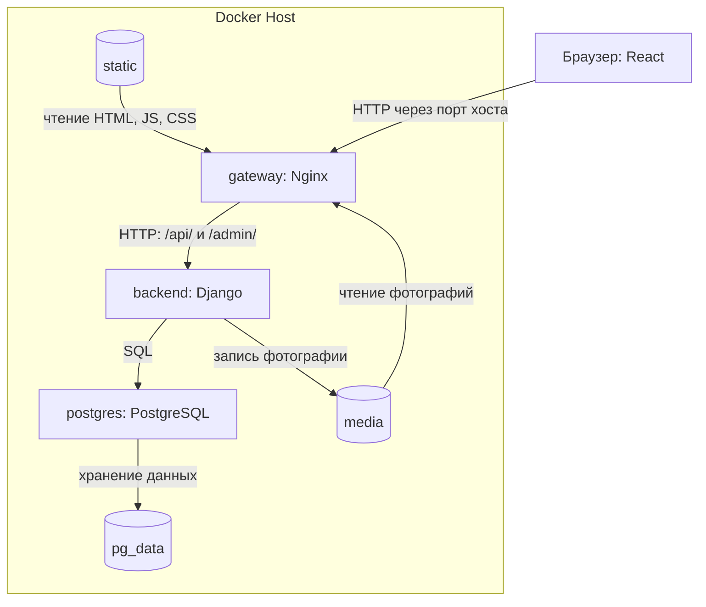
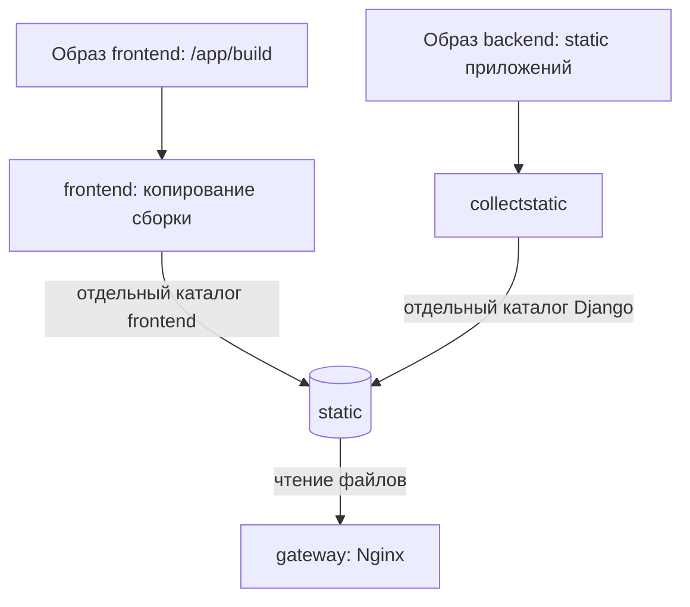

# Этап 1. Архитектура Kittygram

[Общий план](README.md) · [Далее: локальная реализация](02-local-implementation.md)

**Результат этапа:** можем объяснить устройство системы до написания инфраструктурных файлов. Схемы ниже описывают целевую архитектуру из задания с уточнениями; текущий репозиторий реализует её лишь частично.

## 1.1. Назначение приложения и роли компонентов

**Разбираем:** пользовательский сценарий — открыть сайт, зарегистрироваться, добавить котика и фотографию. Связываем каждое действие с компонентами.

| Компонент | Его работа | Где выполняется |
|---|---|---|
| React | Показывает интерфейс и отправляет запросы к API | В браузере после загрузки JS |
| `frontend` | Предоставляет готовые HTML, JS и CSS; в выбранной схеме копирует сборку в общий том | Временный контейнер при развёртывании |
| `gateway` / Nginx | Принимает HTTP, выдаёт файлы, направляет API и админку к бэкенду | Постоянный контейнер |
| `backend` / Django | Авторизация, проверки данных, операции с котиками, админка | Постоянный контейнер с сервером приложения |
| `postgres` | Хранит пользователей, котиков и другие записи | Постоянный контейнер PostgreSQL |
| Docker Engine | Управляет контейнерами, сетями и томами | На Docker Host |

Отдельно определяем Docker Host: среда, где работает Docker Engine. На учебном сервере это Linux-машина; при типичной настройке Docker Desktop с Linux-контейнерами на Windows Engine работает в Linux-среде Desktop/WSL2. Терминал запускает Docker CLI — клиент, который обращается к Engine.

**Работа:** соотносим таблицу с каталогами `frontend/`, `backend/`, `nginx/`. Находим, какие компоненты уже написаны авторами приложения, а какую связку предстоит настроить нам.

**Готово, когда:** можем назвать ответственного за интерфейс, HTTP-маршрутизацию, бизнес-логику и данные. Понимаем, почему четыре сервиса в Compose не означают четыре самостоятельно написанных микросервиса.

## 1.2. Как проходят запросы

Это схема обслуживания уже запущенного приложения. Файлы показаны отдельно от сервисов; стрелки чтения файлов не являются сетевыми запросами.

**Разбираем три сценария:**

1. **Открытие сайта.** Nginx отдаёт `index.html` и файлы сборки. Браузер выполняет React; запросы API появляются отдельно.
2. **Список котиков.** Браузер запрашивает `/api/...`; Nginx передаёт запрос Django; Django работает с PostgreSQL и возвращает JSON.
3. **Фотография.** Загрузка проходит через API в Django: файл сохраняется в `media`, данные о нём — в PostgreSQL. При просмотре фотографии Nginx читает файл из `media` по URL `/media/...`.

Админка `/admin/` создаётся Django. Её CSS и JavaScript — отдельная статика; работающий API ещё не означает, что стили админки настроены.

**Работа:** рисуем маршруты страницы, списка котиков и изображения. Различаем HTTP-ответ, SQL-запрос и операцию с файлом.

**Готово, когда:** можем объяснить, почему React не обращается напрямую к PostgreSQL и почему отсутствие фотографии возможно даже при сохранённой записи о котике.

## 1.3. Что собирается и что запускается

**Разбираем:** исходники, зависимости, результат сборки, Docker-образ, контейнер и процесс. Образ служит шаблоном файловой системы и параметров запуска; контейнер может быть создан, запущен, остановлен или удалён.

В текущем [Dockerfile фронтенда](../../frontend/Dockerfile) `npm ci` устанавливает зависимости по lock-файлу, `npm run build` создаёт `/app/build`, а `CMD` запускает `http-server`. Для целевой архитектуры выбираем другое поведение при развёртывании: контейнер передаёт уже собранные файлы в `static`, Nginx их обслуживает. Возможный способ — переопределить `command` в Compose, сохранив выданный Dockerfile.

Следующая схема показывает подготовку файлов, а не HTTP-трафик:

**Работа:** распределяем `npm ci`, `npm run build`, запуск сервера Django, копирование статики и SQL-запрос по времени выполнения: сборка образа, развёртывание, обработка запроса. Сопоставляем назначение Dockerfile и Compose: первый описывает образ, второй — запуск и связи сервисов.

**Готово, когда:** можем объяснить, почему завершившийся `frontend` с кодом `0` допустим в выбранной схеме, а завершившийся `backend` оставляет сайт без API. Пересоздание контейнера не равно пересборке образа.

## 1.4. Сеть, имена и порты

**Разбираем:** внешний адрес сервера, опубликованный порт хоста, внутренний порт процесса, DNS-имя сервиса в сети Compose.

| Кто обращается | Адрес для нашей схемы | Что означает |
|---|---|---|
| Браузер | `http://<адрес-хоста>:<внешний-порт>` | Вход через опубликованный порт gateway |
| Nginx | `backend:<порт-сервера-приложения>` | Внутреннее соединение с Django |
| Django | `postgres:5432` | Внутреннее соединение с PostgreSQL |

Внешний порт выбираем после проверки свободных портов. Внутренний порт Nginx в шаблоне — `80`; порт бэкенда зафиксируем в Dockerfile и конфигурации Nginx одинаково. Для связи backend–postgres публикация порта базы на хост не требуется.

`localhost` внутри контейнера указывает на этот контейнер. Имя `postgres` работает внутри соответствующей сети Compose; браузер пользователя его не использует. `EXPOSE` в Dockerfile само по себе не публикует порт на хост.

**Работа:** объясняем пример соответствия `<внешний-порт>:80`, затем меняем только внешний порт на схеме и проверяем, какие соединения затронуты.

**Готово, когда:** можем объяснить ошибку `DB_HOST=localhost` при отдельном контейнере PostgreSQL и указать, где искать проблему, если браузер не достигает gateway.

## 1.5. Где живут файлы и данные

| Том | Содержимое | Кто записывает | Кто читает | Можно восстановить одной сборкой? |
|---|---|---|---|---|
| `static` | Сборка React и собранная статика Django | frontend и служебная команда backend | gateway | Да, из соответствующих исходников и зависимостей |
| `media` | Фотографии пользователей | backend | backend и gateway | Нет |
| `pg_data` | Файлы базы PostgreSQL | postgres | postgres | Нет |

**Разбираем:** отличие тома от слоя контейнера, имени тома от пути монтирования, статики от пользовательских данных. Один том может быть подключён к разным контейнерам по разным путям. Существующий непустой том скрывает содержимое каталога образа в точке монтирования. Новый пустой том Docker по умолчанию может заполнить файлами из этого каталога, но замена образа не обновляет уже существующий том.

Для frontend и Django заранее выбираем разные каталоги внутри `static` и согласуем URL-префиксы. Сейчас React и Django используют `/static/`: либо задаём Django отдельный `STATIC_URL`, либо явно разделяем выдачу файлов конфигурацией Nginx. Так обновление React не стирает стили админки, а `collectstatic` не подменяет файлы фронтенда. Первоначальное заполнение тома не используем как механизм обновления: при каждом развёртывании явно переносим нужную версию сборки.

**Работа:** для удаления контейнера, удаления образа и удаления тома отдельно предсказываем последствия. Объясняем, почему новая версия frontend требует повторного обновления файлов в томе.

**Готово, когда:** знаем, где находится фотография, что хранит БД и какие данные переживут замену контейнеров. Том на одном сервере не считаем резервной копией от потери этого сервера.

## 1.6. Конфигурация, готовность и служебные операции

**Разбираем четыре группы настроек и действий:**

- **Конфигурация:** имя БД, адрес, порт, пользователь, пароль, `SECRET_KEY`, `DEBUG`, разрешённые хосты. В Git хранится пример, реальные значения передаются нужным процессам.
- **Передача переменных:** `.env` для подстановки значений в Compose и `environment`/`env_file` для окружения контейнера решают связанные, но разные задачи. Наличие файла рядом с Compose не передаёт автоматически все его значения приложению.
- **Подготовка:** миграции создают или изменяют схему БД; `collectstatic` собирает статические файлы Django. Они не запускаются автоматически от одного факта сборки Docker-образа.
- **Жизненный цикл:** процесс PostgreSQL может уже стартовать, но ещё не принимать соединения. Проверка готовности и порядок запуска решают эту зависимость; логи помогают наблюдать сбой, корректная остановка — завершать работу.

Знакомимся с сервером приложения Gunicorn: он запускает Django и принимает HTTP от Nginx. Уточняем, что Nginx, Gunicorn и Django выполняют разные роли.

**Работа:** для каждой переменной указываем потребителя и момент чтения. На схеме отмечаем, когда БД должна стать готовой, где запускаются миграции и где появляется статика. Проверяем, что секреты не попадают в JS-сборку браузера.

**Готово, когда:** можем объяснить отличие «контейнер работает» от «приложение готово», а также почему замена пароля в `.env` не обязана менять пароль уже инициализированной базы.

## 1.7. Как версия попадает на сервер

**Разбираем:** GitHub хранит исходники, runner выполняет workflow, Docker Hub хранит образы, сервер запускает контейнеры. Образы трёх собственных сервисов связываем с одним коммитом; точную версию выбираем через тег или digest.

| Часть процесса | Вход | Результат |
|---|---|---|
| Проверки до сборки | Исходники и зависимости | Решение, можно ли продолжать |
| Сборка и публикация | Проверенный коммит | Три доступных образа определённой версии |
| Развёртывание | Образы, конфигурация, сохранённые тома | Обновлённые сервисы и подготовленные файлы/БД |
| Приёмочная проверка | Адрес готового сайта и сведения об образах | Подтверждение доступности результата |

Понимаем изоляцию jobs: `needs` задаёт порядок, но не переносит установленный `node_modules`, файлы или локальные Docker-образы на другой runner. В нашем маршруте опубликованные образы передаются через registry.

Связываем с Twelve-Factor: внешняя конфигурация, разделение сборки и запуска, постоянные данные вне заменяемого контейнера приложения, логи в стандартные потоки и отдельные служебные команды. Хранение состояния PostgreSQL в томе не делает контейнер Django местом постоянного хранения данных.

**Работа:** объясняем две ситуации: тест провалился до публикации; новая версия запустилась, но приёмочная проверка провалилась. Затем обсуждаем, почему откат образов не откатывает автоматически миграции БД.

**Этап завершён, когда можем без подсказки:**

- Проследить открытие страницы, API-запрос и загрузку/чтение фотографии.
- Назвать назначение четырёх сервисов и трёх томов.
- Различить внешний порт, внутренний порт и имя сервиса.
- Объяснить роль одноразового frontend и обновления статики.
- Разделить код, образ, конфигурацию и пользовательские данные.
- Рассказать, как коммит станет работающей версией и какие данные останутся при обновлении.

После этого переходим к [этапу 2](02-local-implementation.md).

## Источники для разбора

- [Задание Kittygram](../../desc.md), [Django URLs](../../backend/kittygram_backend/urls.py), [модели котиков](../../backend/cats/models.py).
- [Docker: сеть Compose и имена сервисов](https://docs.docker.com/compose/how-tos/networking/).
- [Docker: тома и их жизненный цикл](https://docs.docker.com/engine/storage/volumes/).
- [Docker: порядок запуска и готовность](https://docs.docker.com/compose/how-tos/startup-order/).
- [Twelve-Factor App](https://12factor.net/ru/).
