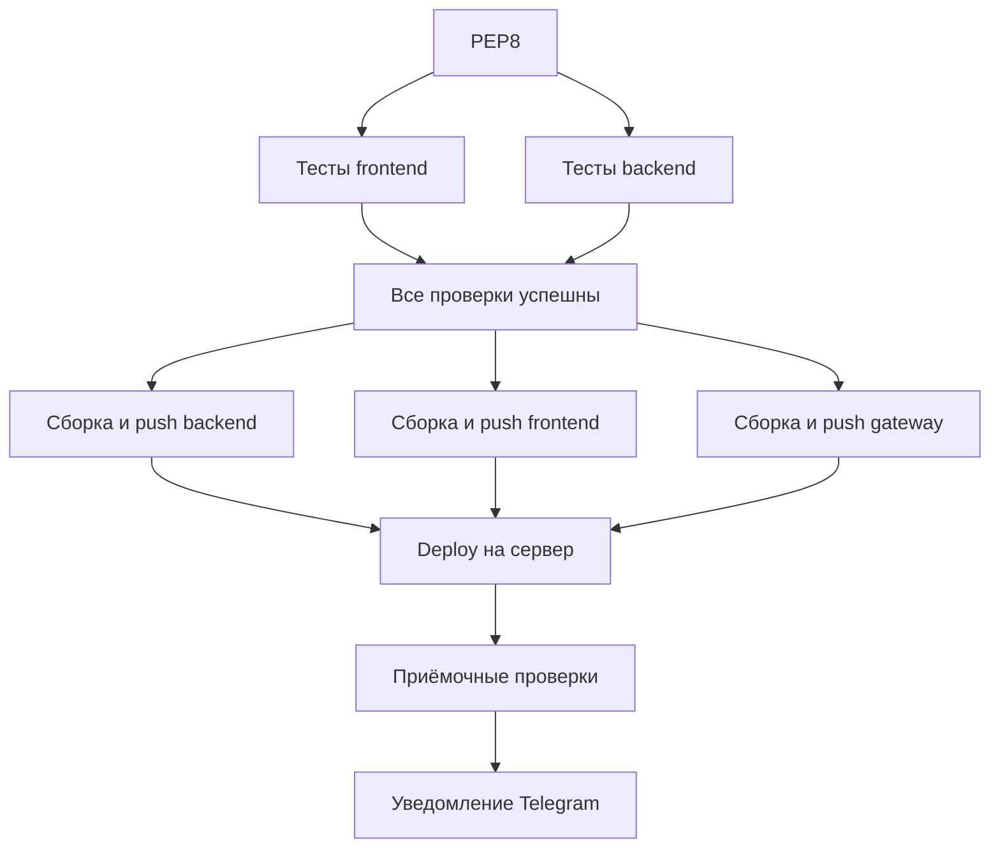

# Этап 3. Сервер, GitHub Actions и проверка доставки

[Общий план](README.md) · [Назад: локальная реализация](02-local-implementation.md)

**Входное условие:** локальный Compose работает и последовательность подготовки приложения проверена. **Результат:** push в `main` запускает проверки, доставляет конкретную версию на учебный сервер, проверяет её и сообщает об успехе.

## 3.1. Разнести тесты по подходящим стадиям

Сначала читаем, что тест запускает и какие ресурсы ему нужны. Название каталога `tests/` этого не объясняет.

| Проверка | Что проверяет в текущем репозитории | Когда выполнять |
|---|---|---|
| PEP8 для backend | Соответствие Python-кода правилам стиля | До сборки образов |
| `frontend/src/components/app/app.test.js` | Отрисовку React-приложения и текст «Вход» | До сборки образов, без сервера |
| Backend-тесты из этапа 2 | Выбранные сценарии приложения через тестовое окружение | До сборки, с отдельной тестовой PostgreSQL |
| `tests/test_files.py` | Нужные файлы, данные для проверки, непустой YAML workflow, отсутствие `build` в production Compose | После создания всех проверяемых файлов; можно включить до сборки |
| `tests/test_dockerhub_images.py` | Доступность трёх публичных репозиториев Docker Hub | После публикации образов |
| `tests/test_connection.py` | Главную страницу, загрузку JS и ответ API работающего сайта | После деплоя и готовности сайта |

Корневой [pytest.ini](../../pytest.ini) направляет `pytest` в `tests/`. Там нет изолированных unit tests бэкенда: HTTP-проверки обращаются к адресу из `tests.yml`. Поэтому до первого деплоя весь этот набор не может быть условием публикации образов.

**Делаем:** фиксируем точные команды для каждого вида проверки, рабочие каталоги, версии Python/Node и зависимости. В зависимости проверок явно включаем используемые инструменты, в том числе `requests`, не полагаясь на случайное транзитивное наличие. Frontend-тесты выполняем однократно, без ожидания изменений файлов.

**Готово, когда:** каждый тест имеет понятную цель, предусловия и стадию. До деплоя проверяется новый код; после деплоя — результат его развёртывания.

## 3.2. Опубликовать образы и научиться определять версию

**Разбираем:** registry, репозиторий образа, тег, digest и отличие Docker Hub от GitHub. Тег технически может быть перемещён; для воспроизводимости договоримся не перезаписывать теги коммитов либо использовать digest.

**Делаем:**

- Подготавливаем три публичных репозитория Docker Hub: `<username>/kittygram_backend`, `<username>/kittygram_frontend`, `<username>/kittygram_gateway`. Публичность требуется предоставленной проверкой Docker Hub.
- Даём всем трём образам версию одного исходного коммита. Если публикуем также `latest`, не используем его как единственный способ узнать, что запущено на сервере.
- Разбираем одну публикацию вручную или на отдельном проверочном запуске: сборка, вход, push, pull по конкретному тегу, проверка запуска.
- Проверяем архитектуру CPU локальной машины, runner и сервера; если они различаются, выбираем подходящую платформу сборки.

**Результат:** понятен путь образа от сборки до скачивания; известны имена и стратегия версий.

**Готово, когда:** каждый нужный образ доступен по выбранной версии и пригоден для сервера. Существование репозитория на Docker Hub ещё не доказывает наличие нужного тега или работоспособность контейнера.

## 3.3. Подготовить сервер и production Compose

**Файлы:** `docker-compose.production.yml`, `.env` на сервере, уточнённый `.env.example`.

**Делаем:**

- Проверяем доступ к учебной Linux-VM, адрес, SSH, ресурсы и свободное место; устанавливаем Docker Engine и Compose по документации для её ОС.
- Создаём `~/kittygram`, выбираем незанятый внешний порт и проверяем сетевой доступ к нему.
- Описываем production Compose через опубликованные `image`. Сервер получает готовые образы; `build` в этом файле запрещён предоставленным тестом.
- Сохраняем сервисы, внутренние адреса, тома и служебные операции из локальной схемы. Используем стабильное имя Compose-проекта, чтобы обновление подключало прежние тома.
- Передаём реальную конфигурацию на сервер. Выбираем один понятный способ: подготовленный серверный `.env` либо создание файла из GitHub Secrets при деплое. Секреты не включаем в Git и вывод команд.
- Проверяем один последовательный запуск: скачивание образов, готовность БД, служебные операции, запуск и HTTP-проверка. Этот пробный проход помогает понять команды до их переноса в workflow.

**Готово, когда:** сервер может запустить опубликованную версию по production Compose и адрес доступен извне. Итоговое обновление дальше обязательно автоматизируем через GitHub Actions.

## 3.4. Описать workflow и зависимости jobs

**Файл:** `.github/workflows/main.yml`.

Предлагаемая логика: сначала быстрая проверка стиля, затем независимые frontend/backend-тесты; сборка и публикация разрешены после успеха всех обязательных проверок. Три образа можно собирать параллельно. Если конкретное разделение jobs окажется избыточным, объединим шаги, сохранив зависимости.

**Разбираем:** `on`, `jobs`, `runs-on`, `steps`, `uses`, `run`, `with`, `env`, `needs`, условия запуска и Secrets. Подбираем актуальные версии Actions во время реализации.

**Делаем:**

- Запускаем доставку по push в `main`. Если добавим `pull_request`, ограничим его проверками, без развёртывания.
- Сразу создаём корневую копию `kittygram_workflow.yml` и синхронизируем её при изменениях workflow. Она нужна до первого запуска файловых и полного набора приёмочных тестов. После подготовки сервера также заполняем реальные публичные сведения в `tests.yml`.
- В каждой job явно готовим код и нужные зависимости. Кэш ускоряет установку, но не заменяет её результат и не является общей файловой системой между jobs.
- Настраиваем тестовую PostgreSQL для backend-проверок. Production-БД в этих тестах не используется.
- Задаём зависимости через `needs`. Если проверка или публикация любого образа провалились, deploy не должен запускаться.
- Разделяем параметры и секреты: Docker Hub token, SSH-ключ, SSH-пользователь и данные Telegram храним в Secrets согласно заданию. Проверку SSH-хоста настраиваем осознанно.
- Сериализуем деплои в одно окружение: два запуска не должны одновременно менять сервер. Учитываем, что отмена job не обязательно остановит уже начатую удалённую команду.

**Готово, когда:** по графу workflow видно, почему job стартовала или пропущена; провал теста не приводит к публикации и обновлению сервера.

## 3.5. Автоматизировать развёртывание

**Разбираем:** состав релиза — выбранные образы, production Compose и конфигурация; постоянные тома сохраняются между релизами. Образы одной версии уже собраны, пересборка на сервере не нужна.

**Делаем управляемую последовательность:**

1. Передаём актуальный production Compose и идентификатор версии; проверяем доступность конфигурации на сервере.
2. Скачиваем все три образа нужной версии до замены работающих контейнеров. Частичный push не должен приводить к смеси новых и старых сервисов.
3. Проверяем готовность PostgreSQL. Планируем порядок миграций и обновления backend с учётом совместимости схемы БД; для учебного проекта допустимо короткое контролируемое окно недоступности.
4. Выполняем миграции и `collectstatic` из нужной версии backend, переносим frontend build. Любая ошибка останавливает дальнейшие шаги.
5. Обновляем постоянные сервисы и проверяем успешное завершение одноразового frontend. Повторное выполнение не должно удалять media или pg_data.
6. Дожидаемся готовности приложения ограниченными повторными проверками и передаём управление приёмочным тестам.

Конкретный порядок команд фиксируем после локальной проверки. Для повторного деплоя явно запускаем обновление статики: старый том не заменяется новым содержимым образа автоматически. Проверяем отсутствие устаревших файлов в каталоге текущей сборки и отсутствие конфликтов с админкой.

**Готово, когда:** push небольшого видимого изменения приводит к соответствующей версии на сайте. На сервере можно установить связь контейнеров с тегами/digest, а данные созданного ранее котика и его фотография сохранены.

## 3.6. Выполнить приёмочные тесты и отправить уведомление

**Файл с публичными сведениями:** `tests.yml` в корне.

Для текущих тестов нужны три простые строки: `repo_owner`, `kittygram_domain`, `dockerhub_username`. Значения задаём без комментариев и кавычек: [conftest.py](../../tests/conftest.py) читает их собственным построчным парсером. Проверка URL в [test_connection.py](../../tests/test_connection.py) принимает формат `http://...`; в рамках задания используем `http://<IP>:<порт>`. Переход на HTTPS требует отдельно учесть это ограничение теста.

**Делаем:**

- После готовности сайта запускаем полный предоставленный `pytest` из корня с нужными зависимостями.
- Проверяем не только статус файловых тестов, но и фактическую версию контейнеров, API, JS/CSS, админку и media.
- Настраиваем сообщение Telegram только после успешных обязательных проверок. Включаем ссылку на сайт и идентификатор версии, без секретов.
- При сбое сохраняем полезные логи. Различаем неудачный deploy, неудачный приёмочный тест и отдельную ошибку отправки уведомления.

**Готово, когда:** проверенная новая версия доступна извне, весь выданный набор тестов проходит, сообщение приходит после него. Выданные тесты не покрывают все пользовательские сценарии, поэтому контроль фотографии и сохранности данных остаётся отдельным пунктом.

## 3.7. Разобрать неудачное обновление и откат

Это небольшой блок эксплуатационного понимания; сложную платформу автоматических откатов не строим.

**Делаем:**

- Учимся находить неудачную job и конкретную удалённую операцию по логам.
- Различаем невозможность скачать образ, ошибку миграции, падение backend и неправильную выдачу статики.
- Сохраняем идентификатор предыдущей работоспособной версии и понимаем, как повторно запустить её образы с подходящей конфигурацией и файлами frontend.
- Проверяем откат на безопасном изменении без несовместимых миграций. Для изменения схемы отдельно оцениваем совместимость и восстановление БД; автоматического «отката всего» от замены тега нет.
- Определяем, что требуется сохранять для восстановления: данные PostgreSQL, media и нужную конфигурацию. Обсуждаем согласованность резервных копий; простое наличие томов не защищает от потери VM.

**Готово, когда:** можем объяснить, что именно возвращает откат образа, какие данные он не меняет и какой следующий шаг нужен при несовместимой миграции.

## 3.8. Подготовить проект к проверке

**Делаем:**

- Дополняем README: назначение компонентов, переменные без реальных секретов, локальный запуск, серверное развёртывание, проверки, диагностика и обновление.
- Проверяем `tests.yml` и доступность указанного адреса.
- Сверяем актуальную `.github/workflows/main.yml` с корневой копией `kittygram_workflow.yml`, созданной в блоке 3.4. GitHub запускает файл в `.github/workflows/`; корневая копия служит требованию задания.
- Проверяем, что `docker-compose.production.yml` использует `image`, в репозитории есть `.env.example`, а реальные секреты не добавлены в коммит.
- Выполняем финальный push в `main` и сохраняем подтверждение: успешный Actions run, версии образов, адрес сайта, результаты приёмочных тестов и уведомление.
- Сверяем каждый пункт [задания](../../desc.md) с реальным результатом, закрываем соответствующие отметки в [плане](README.md).

**Финальный критерий:** проект проходит путь от коммита до работающей версии без ручной правки кода на сервере; действия workflow объяснимы, данные сохраняются, инструкция позволяет повторить запуск.

## Источники для реализации

- [GitHub Actions: зависимости jobs](https://docs.github.com/en/actions/how-tos/write-workflows/choose-what-workflows-do/use-jobs).
- [GitHub Actions: использование секретов](https://docs.github.com/en/actions/how-tos/write-workflows/choose-what-workflows-do/use-secrets).
- [Docker: production-развёртывание с Compose](https://docs.docker.com/compose/how-tos/production/).
- [Предоставленные проверки файлов](../../tests/test_files.py), [Docker Hub](../../tests/test_dockerhub_images.py), [работающего сайта](../../tests/test_connection.py).
